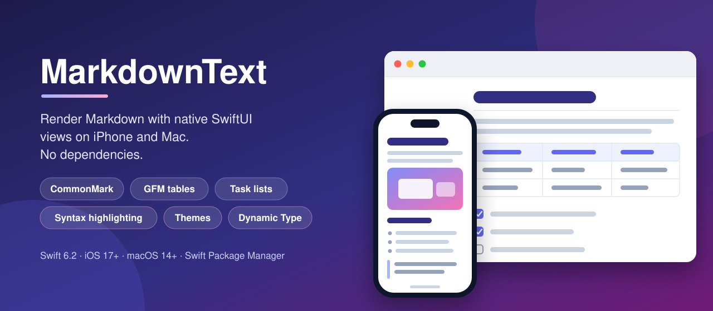
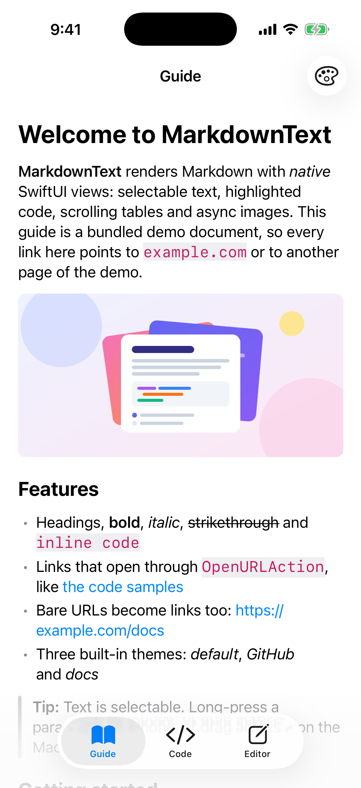
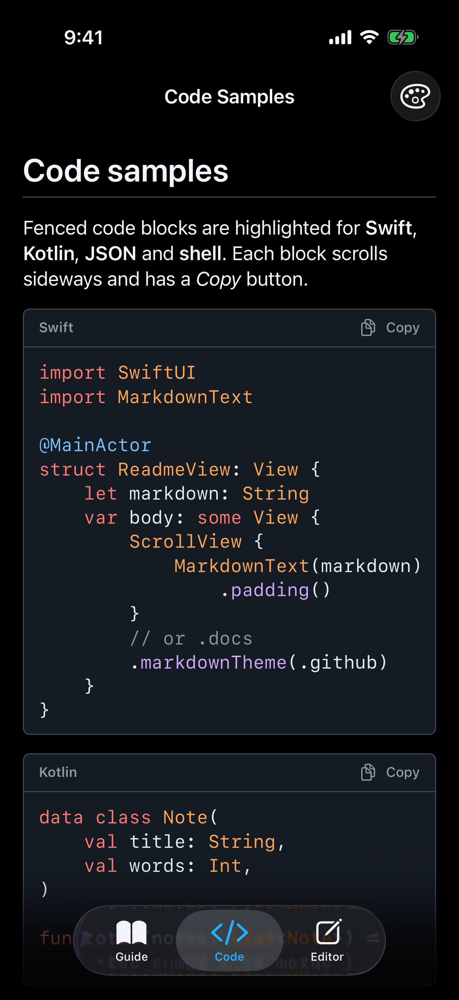
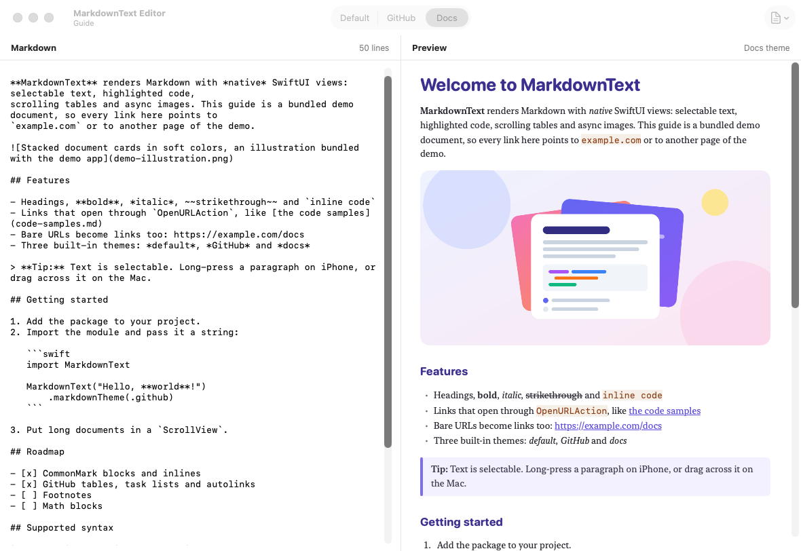

<p align="center">
  
</p>

<p align="center">
  <a href="https://github.com/halilozel1903/MarkdownText/actions/workflows/ci.yml"></a>
  
  
  
  
  
  <a href="LICENSE"></a>
</p>

**MarkdownText** renders Markdown in SwiftUI apps on **iPhone and Mac** with native views, not a web view. Its own parser handles **CommonMark** and the **GitHub Flavored Markdown** extensions (tables, task lists, strikethrough and links for bare URLs) and builds a block tree. Each block is drawn with SwiftUI: **selectable text**, **code blocks with syntax highlighting** for Swift, Kotlin, JSON and shell and a **copy button**, **tables that scroll sideways**, **async images**, links that go through **`OpenURLAction`**, three **themes** (default, GitHub and docs) with a theming API, and **Dynamic Type**. Written in Swift 6 with strict concurrency and no dependencies.

```swift
import MarkdownText
import SwiftUI

struct ReadmeView: View {
    let markdown: String

    var body: some View {
        ScrollView {
            MarkdownText(markdown, baseURL: URL(string: "https://example.com/docs/"))
                .padding()
        }
        .markdownTheme(.github)
    }
}
```

## Screenshots

Captured by CI from the example app on an iPhone simulator and on the Mac. MarkdownText is a UI library, so the screens render the example app's **bundled demo documents**: a README-style guide and a page of code samples, generic sample text written for the demo about the library itself, plus a bundled illustration. Nothing is loaded from the network.

| Guide (default theme) | Code samples (GitHub theme, dark mode) |
| :---: | :---: |
|  |  |



## Installation

Add the package in Xcode with **File > Add Package Dependencies…** and the URL `https://github.com/halilozel1903/MarkdownText`, or in `Package.swift`:

```swift
dependencies: [
    .package(url: "https://github.com/halilozel1903/MarkdownText.git", from: "1.0.0"),
],
targets: [
    .target(name: "MyApp", dependencies: ["MarkdownText"]),
]
```

## Usage

### Render a string or a parsed document

```swift
MarkdownText("# Hello\n\nSome **bold** text and a [link](https://example.com).")

// Parse once, render many times (parsing is pure and can run off the main actor).
let document = MarkdownDocument(parsing: markdown)
MarkdownText(document)
```

`MarkdownText` stacks its blocks vertically and does not scroll; put long documents in a `ScrollView`.

### Relative links and images

Relative URLs resolve against `baseURL`. It can be a web address, or a file URL such as `Bundle.main.resourceURL` for images bundled with the app (the example app shows its illustration this way):

```swift
MarkdownText(guide, baseURL: Bundle.main.resourceURL)   //  loads from the bundle
```

Images load asynchronously, are cached in memory, are never drawn wider than their natural size and show their description when they cannot be loaded. A paragraph made only of images, such as a row of badges, flows the images in rows; a linked image opens its link.

### Handle links

Links are tappable `Text` links, so they open through the environment's `openURL` action. Set your own `OpenURLAction` to route them:

```swift
MarkdownText(markdown)
    .environment(\.openURL, OpenURLAction { url in
        if url.pathExtension == "md" {
            router.open(url)          // open another document in the app
            return .handled
        }
        return .systemAction          // everything else opens in the browser
    })
```

### Themes

```swift
.markdownTheme(.default)   // system fonts, accent-colored links, Xcode-like code colors
.markdownTheme(.github)    // GitHub's colors, dividers under H1 and H2, GitHub syntax colors
.markdownTheme(.docs)      // serif body, rounded indigo headings, tinted quotes, warm code colors
```

Every property of `MarkdownTheme` is a `var`, so you can start from a built-in theme and change what you need:

```swift
let brand = MarkdownTheme.github.with {
    $0.linkColor = .pink
    $0.headingFonts[0] = .system(.largeTitle, design: .rounded, weight: .heavy)
    $0.codeColors.keyword = .orange
    $0.showsCodeCopyButton = false
    $0.blockSpacing = 20
}

MarkdownText(markdown)
    .markdownTheme(brand)
```

Fonts are built from text styles, so text follows **Dynamic Type**, and spacing scales with it. Colors adapt to light and dark mode.

### Parse without rendering

The parser is public, which is handy for previews, search indexes or tests:

```swift
let document = MarkdownDocument(parsing: "- [x] Ship it")
if case let .list(list) = document.blocks.first {
    print(list.items.first?.isChecked)  // Optional(true)
}
print(document.plainText)               // "Ship it"

let tokens = SyntaxHighlighter.tokens(for: "let x = 1", language: .swift)
```

## API

| Symbol | Description |
| --- | --- |
| `MarkdownText(_ markdown: String, baseURL: URL? = nil)` | The view: parses and renders Markdown. |
| `MarkdownText(_ document: MarkdownDocument, baseURL: URL? = nil)` | Renders a document parsed earlier. |
| `.markdownTheme(_:)` / `EnvironmentValues.markdownTheme` | Sets the theme of `MarkdownText` views inside a view. |
| `MarkdownTheme` | Fonts, colors and spacing; `.default`, `.github`, `.docs`, `with { … }`, `headingFont(level:)`. |
| `MarkdownCodeColors` | Syntax colors by token kind; `.xcode`, `.github`, `.warm`. |
| `MarkdownDocument(parsing:)` | Parses Markdown into `blocks: [MarkdownBlock]`; `plainText`. |
| `MarkdownParser.parse(_:)` / `parseInlines(_:)` | The parser, for whole documents or inline text. |
| `MarkdownBlock` | `heading`, `paragraph`, `blockQuote`, `list`, `codeBlock`, `table`, `thematicBreak`. |
| `MarkdownInline` | `text`, `softBreak`, `lineBreak`, `code`, `emphasis`, `strong`, `strikethrough`, `link`, `image`, `html`. |
| `MarkdownList`, `MarkdownListItem` | Ordered or bullet, start number, tight or loose; items with `isChecked` for task lists. |
| `MarkdownTable`, `MarkdownTableAlignment` | Header, rows and per-column alignment. |
| `SyntaxHighlighter.tokens(for:language:)` | Splits code into `CodeToken`s of a `CodeTokenKind`. |
| `CodeLanguage(infoString:)` | `swift`, `kotlin` (`kt`), `json`, `shell` (`sh`, `bash`, `zsh`, `console`). |

## Supported Markdown

| CommonMark | GitHub Flavored Markdown |
| --- | --- |
| ATX (`#`) and setext (`===`, `---`) headings | Tables with `:---`, `:---:` and `---:` alignment |
| Paragraphs, soft and hard line breaks | Task list items (`- [ ]`, `- [x]`) |
| `*emphasis*`, `**strong**`, `` `code` `` | `~~strikethrough~~` |
| Inline, reference, collapsed and shortcut links | Bare `https://`, `http://` and `www.` links |
| Images, `<autolinks>` and email autolinks | |
| Block quotes, nested, with lazy continuation | |
| Bullet and ordered lists, nested, tight and loose | |
| Fenced (backtick and tilde) and indented code blocks | |
| Thematic breaks, backslash escapes, entity references | |

HTML blocks are shown as text and inline HTML is dropped, except `<br>`, which becomes a line break. Footnotes and math are not supported.

## Example app

The `Example` folder contains the *MarkdownText* demo, using bundled demo documents only:

- **iPhone**: the guide, a page of code samples, and an editor with Write and Preview modes. A theme menu switches between the three themes, and the guide's link to the code samples is routed to the Code tab by an `OpenURLAction`.
- **Mac**: a live editor, Markdown on the left and the preview on the right, with a theme picker and a menu to load the sample documents.

The project uses [XcodeGen](https://github.com/yonaskolb/XcodeGen) so no project file has to live in the repo:

```bash
brew install xcodegen
cd Example && xcodegen generate
open MarkdownTextDemo.xcodeproj
```

Run `MarkdownPhone` on an iPhone simulator and `MarkdownMac` on the Mac. Launch with `-screenshot document|code` (iPhone) or `-screenshot editor` (Mac) to open the scene CI captures.

## Requirements

- Xcode 26 or later (Swift 6.2 toolchain)
- iOS 17+ or macOS 14+

## Contributing

Issues and pull requests are welcome. Please run the tests before opening a PR:

```bash
swift test
bash scripts/test.sh iOS
```

## License

MarkdownText is available under the MIT license. See [LICENSE](LICENSE).
